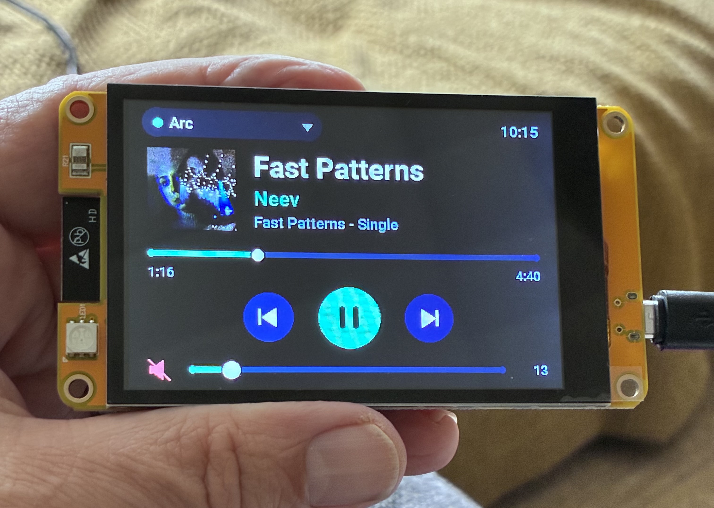
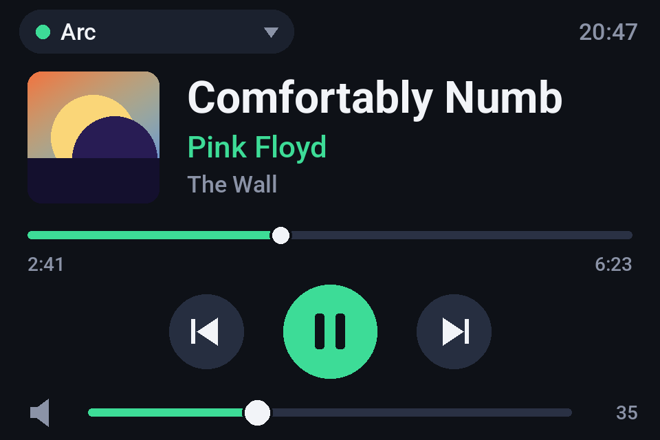
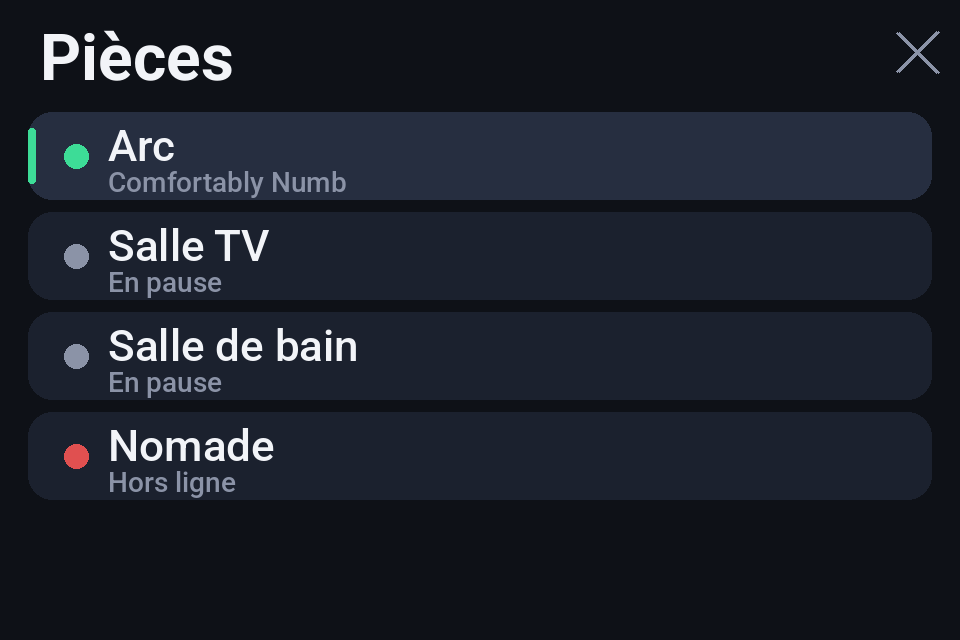

# ESP32 Sonos Touch Controller


A standalone touchscreen remote for **Sonos**, running **ESPHome** on an **ESP32-3248S035C** (3.5" ST7796 480×320 display
with GT911 capacitive touch) and talking to **Home Assistant**.

## Features

- Landscape 480×320 dark UI: title, artist, album (long text scrolls), **96×96 album cover**, progress bar, clock
- Play / pause, previous, next, **volume slider**, **mute** (tap the speaker icon)
- **Multi-room**: tap the room chip (top left) to pick a Sonos player
- **Screen sleep**: stays on while any room is playing; once nothing plays it dims after 30 s and the backlight turns off after 2 min. Any touch (or a playback start) wakes it; the touch that wakes it is ignored
- **Follows the music**: if the displayed room is paused while another one is still playing, the display switches to the playing room
- Smooth partial redraw: only the part of the screen that changes is repainted
- OTA updates, backlight exposed as a light in Home Assistant

## Preview

<p align="center">
  
</p>

*The controller running on the ESP32-3248S035C.*

| Player | Room picker |
|---|---|
|  |  |

*Renderings generated from the UI code (same layout, colours and fonts as the firmware) with sample data; the cover is an illustration.*

## Hardware

**ESP32-3248S035C** — ESP32 (dual core, 4 MB flash, no PSRAM), 3.5" 320×480 **ST7796** display, **GT911** capacitive touch,
CH340 USB serial. Pinout and notes: [`hardware.md`](hardware.md). No wiring required.

## Installation

1. **Install ESPHome** (tested with 2026.10): `pipx install esphome`
2. **Create your secrets**: `cp secrets.yaml.example secrets.yaml` and fill in Wi-Fi (2.4 GHz), an OTA password, and the
   address of Home Assistant (plain `http://`, reachable from the ESP32 — used to download covers).
3. **Declare your Sonos players** in the `packages:` section of `sonos-touch.yaml`, one line per room
   (entity ids are in Home Assistant → Developer tools → States, filter `media_player`):
   ```yaml
   packages:
     room0: !include {file: room.yaml, vars: {idx: "0", entity: media_player.arc, label: "Arc"}}
     room1: !include {file: room.yaml, vars: {idx: "1", entity: media_player.kitchen, label: "Kitchen"}}
   ```
   Up to 5 rooms are shown in the picker. With a single room, the picker is disabled.
4. **Flash the first time over USB** (you may need to be in the `dialout` group: `sudo usermod -aG dialout $USER`):
   ```
   esphome run sonos-touch.yaml
   ```
   Later updates can be done over Wi-Fi with the same command.
5. In Home Assistant, **Settings → Devices & services → ESPHome → Sonos Touch → Configure**, tick
   *Allow the device to perform Home Assistant actions* — otherwise the buttons do nothing.

## Configuration

Settings are in the `substitutions:` block of `sonos-touch.yaml`:

| Key | Default | Meaning |
|---|---|---|
| `dim_after_s` | 30 | seconds of silence (nothing playing, no touch) before dimming |
| `sleep_after_s` | 120 | seconds of silence before the backlight turns off |
| `dim_level` | 0.15 | dimmed brightness (0–1) |
| `ha_url` | from `secrets.yaml` | Home Assistant URL used for covers |

UI texts ("Hors ligne", "Pièces", "Rien en lecture") are in French and can be changed in `ui.h`.

## Project layout

| File | Role |
|---|---|
| `sonos-touch.yaml` | main ESPHome configuration (hardware, display, touch, scheduler, actions) |
| `room.yaml` | package instantiated once per Sonos room (subscribes to the Home Assistant `media_player`) |
| `ui.h` | all drawing code and touch handling (zones, room picker, marquee, calibration) |
| `secrets.yaml.example` | template for `secrets.yaml` (git-ignored) |
| `hardware.md` | board, pinout, touch orientation |
| `docs/` | preview images used in this README |

## How it works

- **Data** comes from Home Assistant through ESPHome's `homeassistant` sensors (state, title, artist, album, volume,
  position, duration, mute, cover path) and is mirrored in a `rooms[]` array.
- **Rendering**: with no PSRAM there is no full frame buffer. The screen is split into zones (header, cover, title,
  artist, album, progress, controls, volume); a 20 ms scheduler repaints **one dirty zone per tick**, round-robin.
  The `mipi_spi` driver aborts an update at the first band where nothing was drawn, so `ui.h` draws a 1-pixel
  background-coloured dot in the bands a zone does not cover.
- **Covers** are downloaded over HTTP from Home Assistant (`entity_picture`), decoded to 96×96 RGB565 and cached by URL.

## Troubleshooting

| Symptom | Cause / fix |
|---|---|
| `Permission denied` on `/dev/ttyUSB0` | add your user to `dialout` (log out/in) or `sudo chmod 666 /dev/ttyUSB0` for a session |
| Screen works but buttons do nothing | allow the device to perform Home Assistant actions (installation step 5) |
| "Hors ligne" / red dot | the entity id is wrong or the player is unavailable in Home Assistant |
| No cover (note icon) | nothing playing, or `ha_url` unreachable/HTTPS (only plain HTTP is supported on this board) |
| Touch lands in the wrong place | recalibrate `map_touch()` in `ui.h` (see `hardware.md`) |
| Resistive board (…035R) | not supported: it has an XPT2046 touch controller |

## Limitations

- No PSRAM: cover art is limited to 96×96; HTTPS is not used for covers.
- Up to 5 rooms in the picker.
- Wi-Fi 2.4 GHz only.

## License

MIT — see [`LICENSE`](LICENSE).
